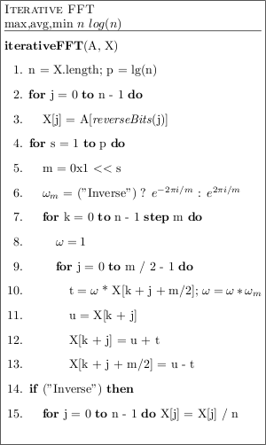
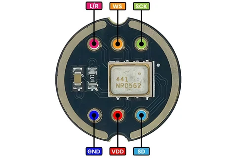
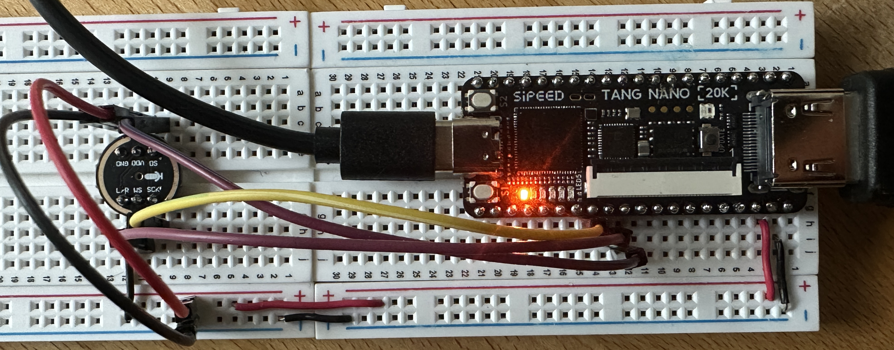

# FPGA Spectrum Analyser
### 
Built for the Tang Nano 20K FPGA development board


## Getting Started

**Flash to Tang Nano 20K**

```bash
# flash volatile sram memory
make flash-sram
# flash nonvolatile memory
make flash
```

**run isolated builds**
```bash
~/oss-cad-suite/bin/yosys -p "read_verilog -sv [FILE_NAME].sv"
```

**Simulation**
```bash
# Run default top integration test
make sim

# Run a specific testbench 
make sim TB=hdmi_clock_gen_tb
make sim TB=top_tb

# View simulation waveforms in GTKWave / Surfer
make waves
make waves TB=hdmi_clock_gen_tb

# Run all testbenches
make test
```

**Check Timing**
```bash
# The final Max frequency lines count, earlier lines are estimates. Multiplier paths are not timed
make -B pnr 2>&1 | grep -E "Max frequency|ERROR"
```

**Format**
```bash
make format
```

**Clean Build Files**
```bash
make clean
```

## Set up toolchain

**Check toolchain status**

```bash
make check-tools
```

**Install OSS CAD Suite**

```bash
make setup-toolchain
```


##
## Implementation Notes

### HDMI
**TMDS encoding (Transition-Minimised Differential Signalling)**: a technology used to transmit high-speed digital video and audio data reliably over cables in interfaces like DVI and HDMI

### Clock Domains
- **Pixel Clock**:  **74.25** MHz for pixel coordinates and RGB colour values once per pixel
1650 pixels wide × 750 lines tall × 60 frames/sec = 74,250,000 pixels/sec.
- **Serial Clock**: 371.25 MHz for 10-bit TMDS encoded colour data over HDMI pins.
- **Audio Clock**: 27 MHz crystal clock for `i2s_rx.sv`, `fft.sv` and writes to the display bars. The single-cycle FFT butterfly is too slow to share the pixel clock.

The phase-locked loop generates the serial clock from the 27 MHz crystal, and `CLKDIV` divides it by 5 to generate the pixel clock.

PLL `LOCK` is asynchronous to every clock, so `top.sv` passes it through one `reset_sync.sv` per clock domain. Reset asserts immediately and releases on a clock edge.

An HDMI cable does not have 10 separate wires for Red, 10 for Green, and 10 for Blue. It only has 1 differential pair per color channel. To squeeze all 10 bits of a pixel's TMDS symbol down a single wire before the next pixel arrives, `hdmi_tx.sv` uses a hardware Parallel-to-Serial converter (`OSER10` — Output Serializer 10:1)

### Bit width calculation for 720p output display
- Active Resolution: 1280 × 720 = 921,600 pixels (Total frame with blanking: 1650 × 750 = 1,237,500 pixels)
- pixel_x [11:0]: 12-bit horizontal coordinate (2^11 = 2048 covers the 1280 active width and 1650 total line width; 12 bits [11:0] gives range 0..4095)
- pixel_y [11:0]: 12-bit vertical coordinate (matched to pixel_x width for consistency)

### FFT (64-Point Iterative Radix-2 DIT)

- **FFT Hardware State Machine**
  1. `S_COLLECT`: Buffers 64 audio samples (`n = 64`) at bit-reversed indices (`reverseBits(j)`) so output bins emerge in normal order.
  2. `S_BUTTERFLY`: Steps sequential counter registers `(s, k, j)` across `p = 6` stages × 32 pairs = 192 clock cycles (1 butterfly/cycle) using Q1.15 fixed-point twiddle ROM tables `src/rom/twiddle_*.hex`
  3. `S_MAGNITUDE`: Computes magnitude for the 32 positive frequency bins to drive the display bars in the top level.

### INMP441 Microphone Wiring



### Pin Diagram from datasheet




| INMP441 | Tang Nano 20K |
| --- | --- |
| VDD | 3V3 |
| GND | GND |
| L/R | GND (selects the left channel) |
| SCK | Pin 27 |
| WS | Pin 28 |
| SD | Pin 29 |

` `
## Source Files

### Clocking and Reset
- **reset_sync.sv**: Asynchronous assert, synchronous deassert reset synchroniser. One instance per clock domain.

### Video Processing
- **hdmi_clock_gen.sv**
  - Generates pixel_clk and faster serial_clk for HDMI.  [Gowin Clock User Guide](<docs/gowin/Gowin Clock User Guide.pdf>).
- **video_sync.sv**
  - pixel_x, pixel_y: Current screen coordinates (0..1279, 0..719).
  - de (Data Enable): High (1) inside the visible 1280 × 720 active area.
  - hsync & vsync: Pulse high (1) during horizontal/vertical sync windows so the monitor can align each row and frame (used by hdmi_tx.sv).
- **tmds_encoder.sv**
  - 8b/10b TMDS encoder implemented from [User Guide (Chapter 3)](<docs/gowin/User Guide.pdf>).
- **hdmi_tx.sv**
  - Wraps the three TMDS encoders, OSER10 10:1 DDR serializers, and differential output buffers.

### Graphics
- **bar_renderer.sv**: Pixel multiplexing to draw bar graphics

### Microphone Driver and Signal Processing
- **i2s_rx.sv**: Driver for I2S microphone. Contains a synchroniser, a clock divider and a shift register.
- **fft.sv**: 64-point iterative FFT. Streams the magnitude of each of the 32 positive frequency bins to the display bars.

### Top Level
- **top.sv**: Top-level FPGA module connecting clocking, reset, the audio path, display bars, rendering, and HDMI output.

### Supplementary
- **spectrum_pattern_gen.sv**: Synthetic animated bar heights for testing without audio input.
