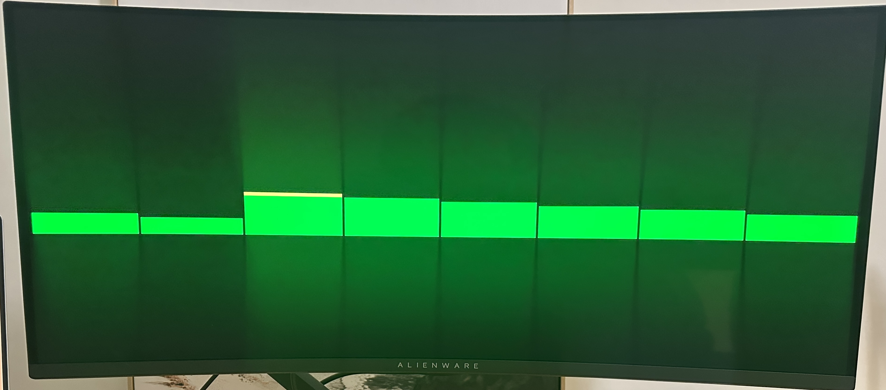

# FPGA Spectrum Analyser
### Work in Progress
Built for the Tang Nano 20K FPGA development board.



## Getting Started

**Flash to Tang Nano 20K**

```bash
# flash volatile sram memory
make flash-sram
# flash nonvolatile memory
make flash
```

**run isolated builds**
```bash
~/oss-cad-suite/bin/yosys -p "read_verilog -sv [FILE_NAME].sv"
```

**Simulation**
```bash
# Run default top integration test
make sim

# Run a specific testbench 
make sim TB=hdmi_clock_gen_tb
make sim TB=top_tb

# View simulation waveforms in GTKWave / Surfer
make waves
make waves TB=hdmi_clock_gen_tb
```

**Clean Build Files**
```bash
make clean
```

## Set up toolchain

**Check toolchain status**

```bash
make check-tools
```

**Install OSS CAD Suite**

```bash
make setup-toolchain
```


## Notes

### HDMI
**TMDS encoding (Transition-Minimized Differential Signaling)**: a technology used to transmit high-speed digital video and audio data reliably over cables in interfaces like DVI and HDMI

### Clock Domains
- Pixel Clock:  74.25 MHz for pixel coordinates and RGB color values once per pixel
1650 pixels wide×750 lines tall×60 frames/sec\=74,250,000 pixels/sec.

- Serial Clock: 371.25 MHz for 10-bit TMDS encoded color data over HDMI pints.
These clocks are genrated by the phase-locked loop

An HDMI cable does not have 10 separate wires for Red, 10 for Green, and 10 for Blue. It only has 1 differential pair per color channel.To squeeze all 10 bits of a pixel's TMDS symbol down a single wire before the next pixel arrives, `hdmi_tx.sv` uses a hardware Parallel-to-Serial converter (`OSER10` — Output Serializer 10:1)


### Coordinate Bit Widths & Resolution
- Active Resolution: 1280 × 720 = 921,600 pixels (Total frame with blanking: 1650 × 750 = 1,237,500 pixels)
- pixel_x [11:0]: 12-bit horizontal coordinate (2^11 = 2048 covers the 1280 active width and 1650 total line width; 12 bits [11:0] gives range 0..4095)
- pixel_y [11:0]: 12-bit vertical coordinate (matched to pixel_x width for consistency)

## Source Files

**Clocking and Reset**
- reset_sync.sv

**Video Processing**
- hdmi_clock_gen.sv: Generates pixel_clk (74.25 MHz) and serial_clk (371.25 MHz). Documented in [Gowin Clock User Guide](<docs/gowin/Gowin Clock User Guide.pdf>).
- video_sync.sv: 720p60 raster timing generator.
  - pixel_x, pixel_y: Current screen coordinates (0..1279, 0..719).
  - de (Data Enable): High (1) inside the visible 1280 × 720 active area.
  - hsync & vsync: Pulse high (1) during horizontal/vertical sync windows so the monitor can align each row and frame (used by hdmi_tx.sv).
- tmds_encoder.sv: 8b/10b TMDS encoder implemented from [User Guide (Chapter 3)](<docs/gowin/User Guide.pdf>).
- hdmi_tx.sv: Wraps the three TMDS encoders, OSER10 10:1 DDR serializers, and differential output buffers.

**Graphics**
- bar_renderer.sv: Pixel multiplexing to draw bar graphics

**Supplementary**
- spectrum_pattern_gen.sv: Synthetic animated bar heights for testing without audio input.

**Microphone driver**
- i2s_rx.sv: driver for i2s microphone. Contains a synchroniser, a clock divider and a shift register
Signal Processing
- fft.sv

**Top Level**
- top.sv: Top-level FPGA module connecting clocking, timing, rendering, and HDMI output.
